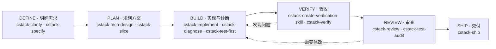

# CStack

CStack 是面向 AI Coding Agent 的工程方法 Skills 包，帮助你从需求澄清、方案设计到实现、验收、审查和交付，按任务需要选择方法。



六个阶段是一张工程工作的地图，不是必须按顺序执行的流水线。可以从当前问题进入，按需跳过上游阶段或返回；目标和验收依据已经清楚的局部修改，可以直接从实现开始。完整的阶段定义与设计取舍见[设计思想](docs/design.md)。

唯一不能跳的是收尾：任何要声明完成的任务，都必须实际运行 [cstack-verify](plugins/cstack/skills/cstack-verify/SKILL.md) 和 [cstack-review](plugins/cstack/skills/cstack-review/SKILL.md)；[cstack-simplify](plugins/cstack/skills/cstack-simplify/SKILL.md) 可以跳过。验收或审查记为未运行的，不等于通过。

## 插件与安装

| 插件 | 定位 |
| --- | --- |
| `cstack` | 工程方法：六阶段方法、共享产物链、可派发的 Agent 角色 |
| `gitlab` | 平台操作：在自部署 GitLab 上完成提交、MR、评审、变基与拆分 |

两个插件职责不同、没有依赖，可以只装其中一个。

```text
/plugin marketplace add calvingit/cstack
/plugin install cstack@cstack
/plugin install gitlab@cstack
```

## 从哪开始

| 阶段 | 主要 Skill |
| --- | --- |
| **DEFINE · 明确需求** | [cstack-clarify](plugins/cstack/skills/cstack-clarify/SKILL.md) · [cstack-specify](plugins/cstack/skills/cstack-specify/SKILL.md) |
| **PLAN · 规划方案** | [cstack-tech-design](plugins/cstack/skills/cstack-tech-design/SKILL.md) · [cstack-slice](plugins/cstack/skills/cstack-slice/SKILL.md) |
| **BUILD · 实现与诊断** | [cstack-implement](plugins/cstack/skills/cstack-implement/SKILL.md) · [cstack-diagnose](plugins/cstack/skills/cstack-diagnose/SKILL.md) · [cstack-test-first](plugins/cstack/skills/cstack-test-first/SKILL.md) |
| **VERIFY · 验收** | [cstack-verify](plugins/cstack/skills/cstack-verify/SKILL.md) |
| **REVIEW · 审查** | [cstack-review](plugins/cstack/skills/cstack-review/SKILL.md) |
| **SHIP · 交付** | [cstack-ship](plugins/cstack/skills/cstack-ship/SKILL.md) |

各阶段的问题描述、配套辅助 Skill（并行编排、性能测量、界面审查、影响半径、原型验证等）、容易选错的场景和触发方式，见 [Skill 参考](docs/skills.md)。

## 文档

| 文档 | 内容 |
| --- | --- |
| [设计思想](docs/design.md) | 定位、六阶段的边界、证据的候选绑定与失效、6 类权威产物、风险自适应与权限分组、强制约束与独立性、角色模型、方法形态 |
| [Skill 参考](docs/skills.md) | 全部 Skill 清单、辅助 Skill 分组、容易选错的场景、触发方式 |
| [GitLab 插件](docs/gitlab.md) | 适用场景、七个技能的分工、glab 陷阱、实例能力矩阵、写操作安全约束 |
| [Agent 角色](docs/agents.md) | 角色契约、可派发的子代理、独立性的判断 |

## 仓库校验

在仓库根目录运行：

```bash
python3 scripts/check_repo.py
```

脚本对 `plugins/` 下每个含 `.claude-plugin/plugin.json` 的目录分别检查：Skill 名与目录一致、描述以中文为主、自动触发的描述写明排除条件、相对链接有效、`plugin.json` 与 `marketplace.json` 版本一致、`openai.yaml` 存在且触发策略与 frontmatter 对齐、共享层以读取文件而非调用 Skill 的方式引用，以及 Skill 和子代理使用该插件自己的前缀。新增插件无需改脚本。GitHub Actions 在推送和 PR 事件上运行同一脚本。
