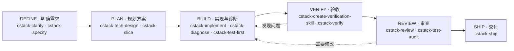

# CStack

CStack 是一套面向 AI Coding Agent 的工程方法 Skills，覆盖需求澄清、方案设计、实现、验收、审查和交付。它不强制每次任务走完整流程，而是把工程判断拆成可按需取用的方法，让验证证据、审查结论和交付决策都绑定到明确的代码候选、环境与授权范围。

[设计思想](docs/design.md) · [Skill 参考](docs/skills.md) · [Agent 角色](docs/agents.md) · [GitLab 插件](docs/gitlab.md) · [报告问题](https://github.com/calvingit/cstack/issues)

## 快速开始

在 Claude Code 中添加插件市场并安装：

```text
/plugin marketplace add calvingit/cstack
/plugin install cstack@cstack
```

安装后直接描述任务即可；标为手动触发的 Skill 需要显式调用。GitLab 插件独立于工程方法，按需安装：

```text
/plugin install gitlab@cstack
```

### 只装一个 Skill

每个 Skill 目录自包含，可以单独复制到项目的 Skills 目录（例如 Claude Code 的 `.claude/skills/`）。不安装 `cstack-core` 也能运行：各 Skill 内嵌了独立运行所需的约束、产物和判据要点。

## 为什么需要 CStack

Coding Agent 能写出可运行的代码，但“能运行”不等于“可交付”。三个问题经常没有明确答案：

- 这段实现是否满足已确认的验收条件？
- 变更引入了哪些可证明的缺陷或风险？
- 现在是否可以合并或发布？

增加流程、文档或多模型投票，都不能自动回答这些问题；流程本身不产生证据。CStack 把判断建立在四件事上：

- **证据绑定候选**：每条验证结论写明候选、环境、执行者、覆盖范围和未覆盖范围；候选或环境变化后，只重判受影响的部分。
- **产物按需启用**：`PROFILE`、`DECISIONS`、`SPEC`、`TECH`、`SLICES`、`EVIDENCE` 六类产物各有唯一写入者，可以省略，但省略不等于没有要求，更不等于可以凭空假设。
- **角色分离判断**：Implementer 不写 `EVIDENCE`；Verifier 判验收条件是否满足，Reviewer 判变更引入了什么缺陷，两者不能合并成一份结论。
- **深度由风险决定**：按不确定性、影响半径、验证难度和可逆性决定设计、验证和审查的深度，不做加权打分。

## 包含什么

### 六阶段地图



六阶段是理解工程工作的地图，不是必须按顺序执行的流水线。可以从当前问题进入，按需跳过上游阶段或返回；目标和验收依据已经清楚、现有检查足够的局部修改，可以直接从实现开始。

唯一不能跳过的是收尾：任何要声明完成的任务，都必须实际运行 [cstack-verify](plugins/cstack/skills/cstack-verify/SKILL.md) 和 [cstack-review](plugins/cstack/skills/cstack-review/SKILL.md)；[cstack-simplify](plugins/cstack/skills/cstack-simplify/SKILL.md) 可以跳过。验收或审查记为未运行的，不等于通过。

### 两个插件

| 插件 | 定位 | Skill 数 |
| --- | --- | --- |
| `cstack` | 工程方法：六阶段、共享产物链、可派发的 Agent 角色 | 39 |
| `gitlab` | 平台操作：自部署 GitLab 实例上的提交、MR、评审、变基与拆分 | 7 |

两个插件职责不同、没有依赖，可以只装其中一个。

### Skill 速览

| 阶段 | 主要 Skill |
| --- | --- |
| **DEFINE · 明确需求** | [cstack-clarify](plugins/cstack/skills/cstack-clarify/SKILL.md) · [cstack-specify](plugins/cstack/skills/cstack-specify/SKILL.md) |
| **PLAN · 规划方案** | [cstack-tech-design](plugins/cstack/skills/cstack-tech-design/SKILL.md) · [cstack-slice](plugins/cstack/skills/cstack-slice/SKILL.md) |
| **BUILD · 实现与诊断** | [cstack-implement](plugins/cstack/skills/cstack-implement/SKILL.md) · [cstack-orchestrate](plugins/cstack/skills/cstack-orchestrate/SKILL.md) · [cstack-diagnose](plugins/cstack/skills/cstack-diagnose/SKILL.md) · [cstack-test-first](plugins/cstack/skills/cstack-test-first/SKILL.md) |
| **VERIFY · 验收** | [cstack-create-verification-skill](plugins/cstack/skills/cstack-create-verification-skill/SKILL.md) · [cstack-verify](plugins/cstack/skills/cstack-verify/SKILL.md) |
| **REVIEW · 审查** | [cstack-review](plugins/cstack/skills/cstack-review/SKILL.md) · [cstack-test-audit](plugins/cstack/skills/cstack-test-audit/SKILL.md) |
| **SHIP · 交付** | [cstack-ship](plugins/cstack/skills/cstack-ship/SKILL.md) |

此外还有按需使用的辅助 Skill：性能测量、界面审查、影响半径、原型验证、状态图、第二遍重写、中文技术写作等，完整清单见 [Skill 参考](docs/skills.md)。

## 工作方式

1. **从当前问题进入**：目标清楚、影响局部且现有检查足够时直接实现；需求、路径或验收说不清时，先用 `cstack-clarify`、`cstack-specify` 或 `cstack-prototype`。
2. **按需形成产物**：只有会被下游引用的事实才写成权威产物，下游按 `R#`、`AC#`、`D#`、`S#` 引用，不复制内容。
3. **实现并自检**：Implementer 在授权范围内修改，记录自检和未解决问题，不写 `EVIDENCE`。
4. **验收与审查**：Verifier 逐个 `AC#` 给出 `PASS` / `FAIL` / `NOT VERIFIED`；Reviewer 审查 diff，找出缺陷与风险。两种判断都不能由实现者作出。
5. **交付**：`cstack-ship` 判断就绪状态；合并与部署各自需要明确授权，就绪不等于已授权。

## 安装方式

### Claude Code

添加市场和安装插件的命令见[快速开始](#快速开始)，两个插件可以只装其中一个。

### Codex

```bash
codex plugin marketplace add calvingit/cstack
```

然后在 Codex 的 Plugins Directory 中选择并安装 `cstack` 或 `gitlab`。

### 其他宿主

每个插件目录都是完整的 Agent Plugins 包，并带有对应宿主的清单文件：

| 宿主 | 清单 |
| --- | --- |
| Claude Code | `.claude-plugin/plugin.json` |
| Codex | `plugin.json`、`.codex-plugin/plugin.json` |
| Cursor | `plugin.json`、`.cursor-plugin/plugin.json` |
| GitHub Copilot | `.github/plugin/plugin.json` |
| Grok Build | `.grok-plugin/plugin.json`；仓库级市场见 `.grok-plugin/marketplace.json` |
| Gemini CLI | `gemini-extension.json` |
| Kimi Code | `kimi.plugin.json` |

把 `plugins/cstack` 或 `plugins/gitlab` 作为插件目录，按宿主文档安装即可。仓库级市场文件位于 `.claude-plugin/marketplace.json`、`.agents/plugins/marketplace.json` 和 `.grok-plugin/marketplace.json`。

## 更新

插件清单中的 `version` 供宿主判断是否更新，发布新版本时要同步改掉所有宿主清单，`check_repo.py` 会校验它们与 `.claude-plugin/plugin.json` 一致。需要立即替换时，也可以直接复制插件目录覆盖安装。

## 文档

| 文档 | 内容 |
| --- | --- |
| [设计思想](docs/design.md) | 定位、六阶段的边界、证据的候选绑定与失效、6 类权威产物、风险自适应与权限分组、强制约束与独立性、角色模型、方法形态 |
| [Skill 参考](docs/skills.md) | 全部 Skill 清单、辅助 Skill 分组、容易选错的场景、触发方式 |
| [GitLab 插件](docs/gitlab.md) | 适用场景、七个技能的分工、glab 陷阱、实例能力矩阵、流水线校验边界、写操作安全约束 |
| [Agent 角色](docs/agents.md) | 角色契约、可派发的子代理、独立性的判断 |

## 仓库校验

在仓库根目录运行：

```bash
python3 scripts/check_repo.py
```

脚本对 `plugins/` 下每个插件分别检查：Skill 名与目录一致、description 只使用中文和允许的英文术语并写成含「时使用」的正向触发语句、相对链接有效、各宿主清单与 `.claude-plugin/plugin.json` 的名称和版本一致、三个市场文件（`.claude-plugin/marketplace.json`、`.agents/plugins/marketplace.json`、`.grok-plugin/marketplace.json`）的条目、版本和 `source` 路径一致、`openai.yaml` 触发策略与 frontmatter 对齐，以及 Skill 和子代理使用该插件自己的前缀。GitHub Actions 在推送和 PR 事件上运行同一脚本。

## 贡献

欢迎提交 Issue 和 PR。改动 Skill 时请同步更新对应的文档索引，并运行 `python3 scripts/check_repo.py`。
