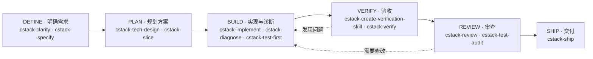

# CStack

CStack 是面向 AI Coding Agent 的工程方法 Skills 包，帮助你从需求澄清、方案设计到实现、验收、审查和交付，按任务需要选择方法。



六个阶段是一张工程工作的地图，不是必须按顺序执行的流水线。可以从当前问题进入，按需跳过上游阶段或返回；例如，目标和验收依据已经清楚的局部修改，可以直接从实现开始。辅助 Skill 不绑定阶段，可跨阶段使用。任何要声明完成的任务，收尾都必须实际运行 [cstack-verify](skills/cstack-verify/SKILL.md) 和 [cstack-review](skills/cstack-review/SKILL.md)；[cstack-simplify](skills/cstack-simplify/SKILL.md) 可以跳过。验收或审查记为未运行的，不等于通过。

**状态：首版 Skill 集，等待用户验证。** Skill 的触发、跨 Runtime 兼容性与相对原生 Agent 的收益均未验证。

## 快速开始

### 安装插件

在 Claude Code 中添加市场并安装：

```text
/plugin marketplace add calvingit/cstack
/plugin install cstack@cstack
```

也可以在命令行使用 `claude plugin marketplace add calvingit/cstack` 和 `claude plugin install cstack@cstack`。更新时分别运行 `claude plugin marketplace update cstack` 和 `claude plugin update cstack@cstack`；Claude Code 依据 `version` 字段判断是否有更新。

### 在测试项目中使用 Skills

将下面的 `CSTACK_ROOT` 改为 CStack 本地克隆路径，再在临时 Codex 测试项目的根目录执行下列命令：

```bash
CSTACK_ROOT="/absolute/path/to/cstack"
mkdir -p .agents/skills
cp -R "$CSTACK_ROOT"/skills/* .agents/skills/
```

建议使用隔离项目，避免覆盖已有配置。安装后，确认目标环境能发现这些 Skill，再分别测试显式调用与自然语言请求。可以从这些任务开始：

> 使用 `$cstack-verify` 验收当前候选变更的已确认需求，提供实际检查对象和证据限制。

> 使用 `$cstack-review` 审查当前变更，报告具体缺陷、触发条件和证据。

> 使用 `$cstack-ship` 判断当前 PR 能否交付，在已授权范围内处理。

## 选择工作流 Skill

| 阶段 | 需要解决的问题 | 主要 Skill |
| --- | --- | --- |
| **DEFINE · 明确需求** | 要做什么，如何判断完成？ | [cstack-clarify](skills/cstack-clarify/SKILL.md)：澄清未决选择；[cstack-specify](skills/cstack-specify/SKILL.md)：整理需求与验收条件 |
| **PLAN · 规划方案** | 哪些技术决策需要确定，如何分步交付？ | [cstack-tech-design](skills/cstack-tech-design/SKILL.md)：确定共享或难以回退的技术选择；[cstack-slice](skills/cstack-slice/SKILL.md)：拆分可验证的纵向切片 |
| **BUILD · 实现与诊断** | 如何实现需求或定位故障？ | [cstack-implement](skills/cstack-implement/SKILL.md)：在授权范围内实现；[cstack-diagnose](skills/cstack-diagnose/SKILL.md)：建立反馈回路并定位根因；[cstack-test-first](skills/cstack-test-first/SKILL.md)：按行为进行测试先行循环 |
| **VERIFY · 验收** | 实际行为是否满足已确认需求？ | [cstack-create-verification-skill](skills/cstack-create-verification-skill/SKILL.md)：建立或更新可重复的验证方法；[cstack-verify](skills/cstack-verify/SKILL.md)：按验收条件核验候选变更 |
| **REVIEW · 审查** | 变更或测试中有哪些可证实的问题？ | [cstack-review](skills/cstack-review/SKILL.md)：审查变更及相关路径；[cstack-test-audit](skills/cstack-test-audit/SKILL.md)：在有疑点时审计测试有效性 |
| **SHIP · 交付** | 当前交付候选是否就绪，授权范围允许做什么？ | [cstack-ship](skills/cstack-ship/SKILL.md)：判断并在授权范围内执行交付 |

## 按需选择辅助 Skill

### 理解问题与设计方案

| Skill | 用途 |
| --- | --- |
| [cstack-research](skills/cstack-research/SKILL.md) | 调查技术事实、比较方案，为决策提供依据 |
| [cstack-impact](skills/cstack-impact/SKILL.md) | 查一项变更的影响半径，并证明决定其是否安全的关键事实 |
| [cstack-architecture-review](skills/cstack-architecture-review/SKILL.md) | 审查现有架构的结构问题及实际代价 |
| [cstack-codebase-design](skills/cstack-codebase-design/SKILL.md) | 用深模块、接缝（Seam）、删除检验等方法设计单个模块 |
| [cstack-wayfinding](skills/cstack-wayfinding/SKILL.md) | 为跨会话的大工程整理地图、未知区域和决策工单 |
| [cstack-challenge](skills/cstack-challenge/SKILL.md) | 对已成形方案做有边界的对抗审查 |
| [cstack-domain-model](skills/cstack-domain-model/SKILL.md) | 梳理业务概念、关系和规则 |
| [cstack-prototype](skills/cstack-prototype/SKILL.md) | 用一次性原型拍板说不清的行为、状态、界面或可行性问题 |

### 改进与协作

| Skill | 用途 |
| --- | --- |
| [cstack-create-project-profile](skills/cstack-create-project-profile/SKILL.md) | 建立或更新稳定的项目工程档案（PROFILE） |
| [cstack-create-design-md](skills/cstack-create-design-md/SKILL.md) | 建立或更新项目的界面设计系统文档（DESIGN.md） |
| [cstack-simplify](skills/cstack-simplify/SKILL.md) | 在请求范围内识别或移除当前已无职责的复杂度 |
| [cstack-second-pass](skills/cstack-second-pass/SKILL.md) | 第一遍已能跑时，用已学到的知识从变更前基线重写更简洁的版本 |
| [cstack-ui-review](skills/cstack-ui-review/SKILL.md) | 根据实际界面与交互检查视觉和可用性 |
| [cstack-performance](skills/cstack-performance/SKILL.md) | 测量性能、定位瓶颈并按授权优化 |
| [cstack-pr-feedback](skills/cstack-pr-feedback/SKILL.md) | 核实并处理 PR 评审意见，区分判断、修改和回复的授权 |
| [cstack-handoff](skills/cstack-handoff/SKILL.md) | 整理可核查的工作状态和下一步 |
| [cstack-retro](skills/cstack-retro/SKILL.md) | 复盘实际任务，提出有依据的改进 |
| [cstack-visual-explain](skills/cstack-visual-explain/SKILL.md) | 用图形解释工程概念、代码流程、方案或 PR 变更 |

### 沟通与理解

以下 Skill 按显式调用设计，不承担工程流程调度。

| Skill | 用途 |
| --- | --- |
| [cstack-rewrite](skills/cstack-rewrite/SKILL.md) | 把答复或指定片段写得更通俗或更精炼，只改写法，不改结论 |
| [cstack-restate-goal](skills/cstack-restate-goal/SKILL.md) | 重述当前目标和边界，不启动访谈 |
| [cstack-how](skills/cstack-how/SKILL.md) | 追踪并解释当前代码怎样运行 |
| [cstack-why](skills/cstack-why/SKILL.md) | 根据项目证据调查设计、约束或改动的原因 |

## 容易选错的场景

| 用户的问题 | 用哪个 | 不用哪个 |
| --- | --- | --- |
| 这个模块的接口设计得合不合理 | [cstack-codebase-design](skills/cstack-codebase-design/SKILL.md) | [cstack-architecture-review](skills/cstack-architecture-review/SKILL.md)（除非跨模块） |
| 这套结构整体有没有问题 | [cstack-architecture-review](skills/cstack-architecture-review/SKILL.md) | [cstack-codebase-design](skills/cstack-codebase-design/SKILL.md) |
| 这个改动会不会在别处打破东西 | [cstack-impact](skills/cstack-impact/SKILL.md)；审查时用 [cstack-review](skills/cstack-review/SKILL.md) 的同一套证明层级 | [cstack-verify](skills/cstack-verify/SKILL.md)（判 AC，不判风险） |
| 应用好慢 | [cstack-performance](skills/cstack-performance/SKILL.md) | [cstack-diagnose](skills/cstack-diagnose/SKILL.md)（除非是明确故障） |
| 这段太啰嗦，或者看不懂 | [cstack-rewrite](skills/cstack-rewrite/SKILL.md) | [cstack-restate-goal](skills/cstack-restate-goal/SKILL.md)（不重述目标） |
| 这个方案有没有问题 | [cstack-challenge](skills/cstack-challenge/SKILL.md) | [cstack-review](skills/cstack-review/SKILL.md)（审的是变更） |
| 这些测试是不是假的 | [cstack-test-audit](skills/cstack-test-audit/SKILL.md) | [cstack-verify](skills/cstack-verify/SKILL.md)（判 AC） |
| 第一遍已经能跑，要从变更前基线重写得更简洁 | [cstack-second-pass](skills/cstack-second-pass/SKILL.md) | [cstack-simplify](skills/cstack-simplify/SKILL.md)（在现有代码上减复杂度） |
| 行为、状态、界面或可行性还说不清，要对照实物拍板 | [cstack-prototype](skills/cstack-prototype/SKILL.md) | [cstack-implement](skills/cstack-implement/SKILL.md)（答案已经清楚就直接做）；[cstack-second-pass](skills/cstack-second-pass/SKILL.md)（已能跑之后从基线重写）；[cstack-simplify](skills/cstack-simplify/SKILL.md)（局部减复杂度） |
| 要定界面的颜色、字体和组件规范 | [cstack-create-design-md](skills/cstack-create-design-md/SKILL.md) | [cstack-tech-design](skills/cstack-tech-design/SKILL.md)（那是技术方案） |
| 当前页面好不好看、交互有没有问题 | [cstack-ui-review](skills/cstack-ui-review/SKILL.md) | [cstack-create-design-md](skills/cstack-create-design-md/SKILL.md)（写的是规范，不审页面） |
| 共享接口、数据模型或迁移怎么定 | [cstack-tech-design](skills/cstack-tech-design/SKILL.md) | [cstack-create-design-md](skills/cstack-create-design-md/SKILL.md)（不写视觉规范） |

## 触发方式

同一个 Skill 在 Claude Code 与 Codex 上的触发方式一致。手动触发的 Skill，在 Claude Code 的 frontmatter 中写 `disable-model-invocation: true`，在 Codex 的 `agents/openai.yaml` 中写 `policy.allow_implicit_invocation: false`；可自动触发的 Skill 两端都允许按描述选用（Claude Code 不禁用模型调用，Codex 为 `allow_implicit_invocation: true`）。描述要与配置一致：手动触发的 Skill 在 description 中写明需要用户显式调用，其余 Skill 的描述要写出可被自动匹配的使用场景。

| 触发方式 | Skill |
| --- | --- |
| 手动触发 | [cstack-rewrite](skills/cstack-rewrite/SKILL.md)<br>[cstack-core](skills/cstack-core/SKILL.md)<br>[cstack-create-project-profile](skills/cstack-create-project-profile/SKILL.md)<br>[cstack-create-design-md](skills/cstack-create-design-md/SKILL.md)<br>[cstack-how](skills/cstack-how/SKILL.md)<br>[cstack-impact](skills/cstack-impact/SKILL.md)<br>[cstack-restate-goal](skills/cstack-restate-goal/SKILL.md)<br>[cstack-second-pass](skills/cstack-second-pass/SKILL.md)<br>[cstack-wayfinding](skills/cstack-wayfinding/SKILL.md)<br>[cstack-why](skills/cstack-why/SKILL.md) |
| 可自动触发 | [cstack-architecture-review](skills/cstack-architecture-review/SKILL.md)<br>[cstack-challenge](skills/cstack-challenge/SKILL.md)<br>[cstack-clarify](skills/cstack-clarify/SKILL.md)<br>[cstack-codebase-design](skills/cstack-codebase-design/SKILL.md)<br>[cstack-create-verification-skill](skills/cstack-create-verification-skill/SKILL.md)<br>[cstack-diagnose](skills/cstack-diagnose/SKILL.md)<br>[cstack-domain-model](skills/cstack-domain-model/SKILL.md)<br>[cstack-handoff](skills/cstack-handoff/SKILL.md)<br>[cstack-implement](skills/cstack-implement/SKILL.md)<br>[cstack-performance](skills/cstack-performance/SKILL.md)<br>[cstack-pr-feedback](skills/cstack-pr-feedback/SKILL.md)<br>[cstack-prototype](skills/cstack-prototype/SKILL.md)<br>[cstack-research](skills/cstack-research/SKILL.md)<br>[cstack-retro](skills/cstack-retro/SKILL.md)<br>[cstack-review](skills/cstack-review/SKILL.md)<br>[cstack-ship](skills/cstack-ship/SKILL.md)<br>[cstack-simplify](skills/cstack-simplify/SKILL.md)<br>[cstack-slice](skills/cstack-slice/SKILL.md)<br>[cstack-specify](skills/cstack-specify/SKILL.md)<br>[cstack-tech-design](skills/cstack-tech-design/SKILL.md)<br>[cstack-test-audit](skills/cstack-test-audit/SKILL.md)<br>[cstack-test-first](skills/cstack-test-first/SKILL.md)<br>[cstack-ui-review](skills/cstack-ui-review/SKILL.md)<br>[cstack-verify](skills/cstack-verify/SKILL.md)<br>[cstack-visual-explain](skills/cstack-visual-explain/SKILL.md) |

## 工作原则

- **验收、审查和交付各有职责**：验收依据已确认需求判断实际行为；审查寻找变更引入的缺陷；交付综合有效证据、项目门禁和授权。验证方法能够运行，也不代表候选变更已经通过验收。
- **收尾必须验收并审查**：要声明任务完成，就必须实际运行验收和审查；验收或审查记为未运行，不等于通过。简化可以跳过，跳过也不等于验收或审查已通过。改动小不能作为省掉验收或审查的理由。
- **证据对应实际对象**：实现、验证和审查需要识别候选变更及相关工作树状态。证据要写明实际受测对象、环境、观察结果和限制条件；条件变化后需重新判断是否适用。
- **辅助判断不产出验收结论**：影响半径、界面、性能、测试审计和对抗审查只提供观察与发现；逐个 `AC#` 的 `PASS` / `FAIL` 只由验收给出。
- **就绪不等于授权或执行**：合并就绪、发布就绪、执行授权和实际结果需分别说明。合并会触发自动部署时，副作用也必须在授权范围内；入队不等于已合并。
- **产物按需使用**：需求确认（DECISIONS）、规格（SPEC）、技术决定（TECH）、切片（SLICES）与证据（EVIDENCE）可以逐级衔接，也可以省略。下游按 ID 引用，不复制内容；缺少可引用的依据时，不得凭空假设。
- **深度与任务相称**：不要求固定文档、独立执行者、全量检查、任务图或新的 Runtime。具体做法由任务风险、项目约束和用户要求决定。

[cstack-core](skills/cstack-core/SKILL.md) 是不自动触发的共享 Skill，供其他 Skill 按需读取文件；读取不会扩大授权。它索引共享判断约束 [PRINCIPLES.md](skills/cstack-core/PRINCIPLES.md)，约定产物字段与 ID 的写法（[ARTIFACTS.md](skills/cstack-core/ARTIFACTS.md)）、共享判据（[CRITERIA.md](skills/cstack-core/CRITERIA.md)）和角色契约（[ROLES.md](skills/cstack-core/ROLES.md)）。安装单个 Skill 时可以不安装 `cstack-core`；各 Skill 内嵌了独立运行所需的约束、产物和判据要点。

## Agent 角色

[ROLES.md](skills/cstack-core/ROLES.md) 定义 5 个核心角色（Explorer、Implementer、Verifier、Reviewer、Simplifier）和 3 个可选角色（Researcher、Architect、Orchestrator）。默认单 Agent；上下文隔离、独立性或并行有实际收益时，才派独立实例。

插件根目录的 [agents/](agents/) 提供 Claude Code 可直接派发的 subagent 定义。Claude Code 可根据 `description` 自动委派，也可在 Task 工具中按 `name` 指定。

| Agent | 主要用途 | 工具边界 |
| --- | --- | --- |
| `cstack-explorer` | 只读事实调查，回传结论、证据和未知项 | 只读工具 + 只读 Bash |
| `cstack-implementer` | 在授权写范围内实现候选并自检 | 读 + 写 + Bash |
| `cstack-verifier` | 按 `R#` / `AC#` 独立判断，写 `EVIDENCE` | 只读 + Bash |
| `cstack-reviewer` | 审查 diff，报告缺陷与影响 | 只读 + Bash |
| `cstack-simplifier` | 可选：收尾时查找多余复杂度 | 只读 + Bash |
| `cstack-researcher` | 查阅仓库外的官方资料与版本信息 | 读 + Web + Bash |
| `cstack-architect` | 对设计提出 2–3 个结构候选 | 只读 + Bash |

Claude Code 的 subagent 不支持嵌套派发，因此 Orchestrator 只保留角色契约，不提供可执行定义；多切片编排由主 Agent 配合 `cstack-slice` / `cstack-wayfinding` 承担。其他 Runtime 可按角色契约使用等价机制；没有独立实例能力时按契约降级，不能伪造独立验证。

Implementer 不写 `EVIDENCE`；Verifier 与 Reviewer 是两种判断，审查不替代逐条验收。任务收尾必须实际执行 Verifier 的验收和 Reviewer 的审查；未运行不等于通过。Simplifier 可以不派。Verifier 必须先依据已确认的验收条件独立得出预期，再看实现；默认允许在同一上下文完成验证，涉及高风险、权限、数据或迁移，或项目明确提出要求时，须使用独立实例。Reviewer 与 Implementer 分离；要求独立执行者时，Implementer 不能同时担任 Verifier 或 Reviewer。只读 Agent 不得修改产品代码、仓库测试或需求。

更多工作流机制和设计取舍见 [设计思想](docs/design.md)。

## 仓库校验

在仓库根目录运行：

```bash
python3 scripts/check_repo.py
```

脚本检查 Skill 名与目录一致、描述存在且以中文为主（只允许少量既有技术术语）、自动触发的描述写明排除条件、相对链接有效、`plugin.json` 与 `marketplace.json` 版本一致、`openai.yaml` 存在且触发策略与 frontmatter 对齐、共享层以读取文件而不是调用 Skill 的方式引用，以及 Skill 和子代理都使用 `cstack-` 前缀。GitHub Actions 在推送和 PR 事件上运行同一脚本。
