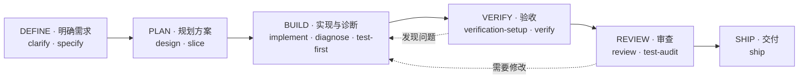

# CStack

CStack 是面向 AI Coding Agent 的工程方法 Skills 包，帮助你从需求澄清、方案设计到实现、验收、审查和交付，按任务需要选择方法。



六个阶段是一张工程工作的地图，不是必须按顺序执行的流水线。可以从当前问题进入，按需跳过或返回；例如，目标和验收依据已经清楚的局部修改，可以直接实现。辅助 Skill 不绑定阶段，可跨阶段使用。

**状态：首版 Skill 集，等待用户验证。** Skill 的触发、跨 Runtime 兼容性与相对原生 Agent 的收益均未验证。

## 快速开始

### 安装插件

在 Claude Code 中添加市场并安装：

```text
/plugin marketplace add calvingit/cstack
/plugin install cstack@cstack
```

也可以在命令行使用 `claude plugin marketplace add calvingit/cstack` 和 `claude plugin install cstack@cstack`。更新时分别运行 `claude plugin marketplace update cstack` 和 `claude plugin update cstack@cstack`；Claude Code 依据 `version` 字段判断是否有更新。

### 在测试项目中使用 Skills

将下面的 `CSTACK_ROOT` 改为 CStack 本地克隆路径，再在临时 Codex 测试项目的根目录执行下列命令：

```bash
CSTACK_ROOT="/absolute/path/to/cstack"
mkdir -p .agents/skills
cp -R "$CSTACK_ROOT"/skills/* .agents/skills/
```

建议使用隔离项目，避免覆盖已有配置。安装后，确认目标环境能发现这些 Skill，再分别测试显式调用与自然语言请求。可以从这些任务开始：

> 使用 `$verify` 验收当前候选变更的已确认需求，提供实际检查对象和证据限制。

> 使用 `$review` 审查当前变更，报告具体缺陷、触发条件和证据。

> 使用 `$ship` 判断当前 PR 能否交付，在已授权范围内处理。

## 选择工作流 Skill

| 阶段 | 需要解决的问题 | 主要 Skill |
| --- | --- | --- |
| **DEFINE · 明确需求** | 要做什么，如何判断完成？ | [clarify](skills/clarify/SKILL.md)：澄清未决选择；[specify](skills/specify/SKILL.md)：整理需求与验收条件 |
| **PLAN · 规划方案** | 哪些技术决策需要确定，如何分步交付？ | [design](skills/design/SKILL.md)：确定共享或难以回退的技术选择；[slice](skills/slice/SKILL.md)：拆分可验证的纵向切片 |
| **BUILD · 实现与诊断** | 如何实现需求或定位故障？ | [implement](skills/implement/SKILL.md)：在授权范围内实现；[diagnose](skills/diagnose/SKILL.md)：建立反馈回路并定位根因；[test-first](skills/test-first/SKILL.md)：按行为进行测试先行循环 |
| **VERIFY · 验收** | 实际行为是否满足已确认需求？ | [verification-setup](skills/verification-setup/SKILL.md)：建立可重复的验证方法；[verify](skills/verify/SKILL.md)：按验收条件核验候选变更 |
| **REVIEW · 审查** | 变更或测试中有哪些可证实的问题？ | [review](skills/review/SKILL.md)：审查变更及相关路径；[test-audit](skills/test-audit/SKILL.md)：在有疑点时审计测试有效性 |
| **SHIP · 交付** | 当前交付候选是否就绪，授权范围允许做什么？ | [ship](skills/ship/SKILL.md)：判断并在授权范围内执行交付 |

## 按需选择辅助 Skill

### 理解问题与设计方案

| Skill | 用途 |
| --- | --- |
| [research](skills/research/SKILL.md) | 调查技术事实、比较方案，为决策提供依据 |
| [impact](skills/impact/SKILL.md) | 追踪变更对调用方、数据和关键不变量的影响 |
| [architecture-review](skills/architecture-review/SKILL.md) | 审查现有架构的结构问题及实际代价 |
| [codebase-design](skills/codebase-design/SKILL.md) | 用深模块、接缝（Seam）、删除检验等方法设计单个模块 |
| [wayfinding](skills/wayfinding/SKILL.md) | 为跨会话的大工程整理地图、未知区域和决策工单 |
| [challenge](skills/challenge/SKILL.md) | 对已成形方案做有边界的对抗审查 |
| [domain-model](skills/domain-model/SKILL.md) | 梳理业务概念、关系和规则 |
| [prototype](skills/prototype/SKILL.md) | 用最小原型检验设计或可行性问题 |

### 改进与协作

| Skill | 用途 |
| --- | --- |
| [project-setup](skills/project-setup/SKILL.md) | 记录稳定的项目工程档案（PROFILE） |
| [simplify](skills/simplify/SKILL.md) | 在请求范围内识别或移除当前已无职责的复杂度 |
| [ui-review](skills/ui-review/SKILL.md) | 根据实际界面与交互检查视觉和可用性 |
| [performance](skills/performance/SKILL.md) | 测量性能、定位瓶颈并按授权优化 |
| [pr-feedback](skills/pr-feedback/SKILL.md) | 核实并处理 PR 评审意见，区分判断、修改和回复的授权 |
| [handoff](skills/handoff/SKILL.md) | 整理可核查的工作状态和下一步 |
| [retro](skills/retro/SKILL.md) | 复盘实际任务，提出有依据的改进 |
| [report-style](skills/report-style/SKILL.md) | 分开汇报工作状态、验证结果和证据 |
| [visual-explain](skills/visual-explain/SKILL.md) | 用图形解释工程概念、代码流程、方案或 PR 变更 |

### 沟通与理解

以下 Skill 按显式调用设计，不承担工程流程调度。

| Skill | 用途 |
| --- | --- |
| [bro](skills/bro/SKILL.md) | 用更通俗的话重述答复或指定片段 |
| [restate-goal](skills/restate-goal/SKILL.md) | 重述当前目标和边界，不启动访谈 |
| [how](skills/how/SKILL.md) | 追踪并解释当前代码怎样运行 |
| [why](skills/why/SKILL.md) | 根据项目证据调查设计、约束或改动的原因 |

## 工作原则

- **验收、审查和交付各有职责**：验收依据已确认需求判断实际行为；审查寻找变更引入的缺陷；交付综合有效证据、项目门禁和授权。验证方法能够运行，也不代表候选变更已经通过验收。
- **证据对应实际对象**：实现、验证和审查需要识别候选变更及相关工作树状态。证据要写明实际受测对象、环境、观察结果和限制条件；条件变化后需重新判断是否适用。
- **就绪不等于授权或执行**：合并就绪、发布就绪、执行授权和实际结果需分别说明。合并会触发自动部署时，副作用也必须在授权范围内；入队不等于已合并。
- **产物按需使用**：需求确认（DECISIONS）、规格（SPEC）、技术决定（TECH）、切片（SLICES）与证据（EVIDENCE）可以逐级衔接，也可以省略。下游按 ID 引用，不复制内容；缺少可引用的依据时，不得凭空假设。
- **深度与任务相称**：不要求固定文档、独立执行者、全量检查、任务图或新的 Runtime。具体做法由任务风险、项目约束和用户要求决定。

[core](skills/core/SKILL.md) 是不自动触发的共享 Skill，供其他 Skill 或用户按需调用；调用不会扩大授权。它索引共享判断约束 [PRINCIPLES.md](skills/core/PRINCIPLES.md)，并约定产物字段与 ID 的写法（[ARTIFACTS.md](skills/core/ARTIFACTS.md)）和角色契约（[ROLES.md](skills/core/ROLES.md)）。安装单个 Skill 时可以不安装 `core`；各 Skill 内嵌了独立运行所需的约束和产物要点。

## Agent 角色

[ROLES.md](skills/core/ROLES.md) 定义 5 个核心角色（Explorer、Implementer、Verifier、Reviewer、Simplifier）和 3 个可选角色（Researcher、Architect、Orchestrator）。默认单 Agent；上下文隔离、独立性或并行有实际收益时，才派独立实例。

插件根目录的 [agents/](agents/) 提供 Claude Code 可直接派发的 subagent 定义。Claude Code 可根据 `description` 自动委派，也可在 Task 工具中按 `name` 指定。

| Agent | 主要用途 | 工具边界 |
| --- | --- | --- |
| `explorer` | 只读事实调查，回传结论、证据和未知项 | 只读工具 + 只读 Bash |
| `implementer` | 在授权写范围内实现候选并自检 | 读 + 写 + Bash |
| `verifier` | 按 `R#` / `AC#` 独立判断，写 `EVIDENCE` | 只读 + Bash |
| `reviewer` | 审查 diff，报告缺陷与影响 | 只读 + Bash |
| `simplifier` | 收尾时查找多余复杂度 | 只读 + Bash |
| `researcher` | 查阅仓库外的官方资料与版本信息 | 读 + Web + Bash |
| `architect` | 对设计提出 2–3 个结构候选 | 只读 + Bash |

Claude Code 的 subagent 不支持嵌套派发，因此 Orchestrator 只保留角色契约，不提供可执行定义；多切片编排由主 Agent 配合 `slice` / `wayfinding` 承担。其他 Runtime 可按角色契约使用等价机制；没有独立实例能力时按契约降级，不能伪造独立验证。

Implementer 不写 `EVIDENCE`；Verifier 与 Reviewer 是两种判断，审查不替代逐 AC 验收。Verifier 必须先依据已确认的验收条件独立得出预期，再看实现；默认允许在同一上下文完成验证，涉及高风险、权限、数据或迁移，或项目明确提出要求时，须使用独立实例。Reviewer 与 Implementer 分离；要求独立执行者时，Implementer 不能同时担任 Verifier 或 Reviewer。只读 Agent 不得修改产品代码、仓库测试或需求。

更多工作流机制和设计取舍见 [设计思想](docs/design.md)。
