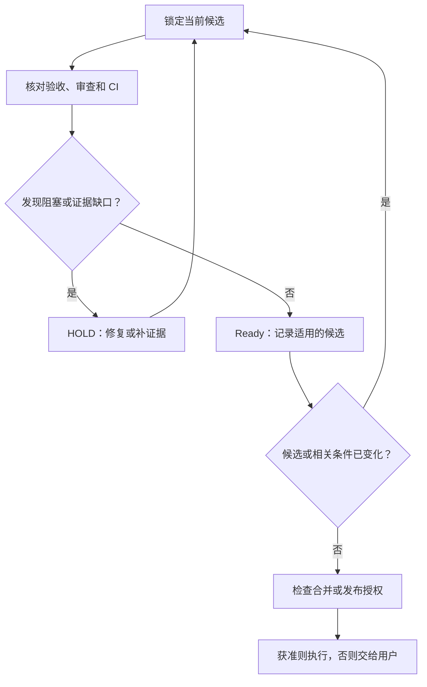

# CStack：面向 AI Coding Agent 的工程体系提案

> 状态：Research Proposal / 待讨论，非实施规范  
> 日期：2026-10-28  
> 范围：研究 Matt Skills、Addy Agent Skills、pstack、tstack，并提出 CStack 的最小可实验架构。  
> 本文只形成方案，不修改 `calvingit/skills`，不创建 CStack 仓库，不授权提交、推送、合并或部署。

## 0. 结论与建议

如果重新设计 CStack，我会采用六阶段生命周期作为用户能理解的工程地图，但不要求每次修改都依次运行六个阶段：

**DEFINE → PLAN → BUILD → VERIFY → REVIEW → SHIP**

四套参考体系中，Matt 提供可组合的工程方法，Addy 提供完整生命周期，pstack 强调深入调查和真实运行证据，tstack 则集中处理 PR 从代码完成到合并的最后一段工作。

CStack 的差异化目标应当是：**在风险自适应的工程流程中，让验证证据、审查结论和交付决策都绑定到明确的代码候选、环境与授权范围，发生相关变化后自动判定证据是否失效。**

第一版优先做最小可验证原型，不以 Skill 数量、自动化程度或多模型共识作为成功指标。相较于从头重写所有工程方法，最需要证明的是 VERIFY、REVIEW、SHIP 三个判断能否减少错误完成声明与风险逃逸。

## 1. 四套体系的研究结论

| 来源 | 主要贡献 | 可吸收的机制 | 不建议照搬 |
| --- | --- | --- | --- |
| Matt Pocock Skills | 开发者与 Agent 的协作方法 | 需求追问、领域语言、纵向切片、按需组合、诊断和 TDD | 固定由 Skill 接管提交及多 Agent 审查习惯 |
| Addy Agent Skills | 完整工程生命周期 | 六阶段入口、项目质量约束、独立审查、Skill 结构/触发/行为评测 | 统一覆盖率和代码行数阈值、通用检查表过载 |
| Cursor pstack | 工程深度与现实反馈 | 先观察再决策、真实运行验证、项目级验证能力、在结构中固化经验 | 过大的 `poteto-mode`、模型路由与宿主特性写进通用方法 |
| t3dotgg tstack | PR 交付后半程 | 显式交付自主权限、与提交关联的证明、有限审查轮次、CI/Review 等待及重新判断、旧 PR 价值重估 | 自然语言自动提升权限、多模型一致即通过、绑定特定 Review Bot 的通用 Ready 条件 |

共同前提是软件工程已有的基本方法仍然有效：明确需求、控制范围、分步实现、运行验证、审查变更和安全发布。Skills 的价值在于让 Agent 稳定选择并执行这些方法，工具与自动化提供可重复的检查。

### 1.1 对 tstack 的深入观察

当前 `main` 有 9 个 Skill。它并不尝试覆盖 DEFINE、PLAN 或整个 BUILD；核心是从已存在的变更出发，持续推进到 PR 可合并或已合并。

**`full-send` / `full-stop`：交付自主权限的两种结果。** 两者共享证明、独立审查、创建 PR、处理 CI 与 Review 的流程。`full-stop` 永不合并，保留最终人类合并决策；`full-send` 在用户明确请求后允许合并。但其正文把某种自然语言口令视为可以覆盖项目内测试询问规则的授权。这种设计不应进入 CStack：权限必须由真实用户授权、项目规则、工具权限共同约束，Skill 或命令不能自行放大权限。

**`sol-loop`：有边界的审查。** 默认最多 3 轮，涉及安全、权限、数据丢失、状态或并发时才在有证据的前提下延长至 5 轮。第一轮审完整变更，后续仅看未解决问题与新修改。每条问题保留 ID、严重程度、修复或拒绝理由；争议和预算耗尽都不等于通过。这比“循环直到 Agent 同意”更可控，适合抽象为跨模型、跨宿主的审查准则。

**`council`：不同供应商的三模型评审。** 它提供独立意见，但要求持续评审直到所有参与者满意，缺少固定总轮次上限；分数也缺乏独立的行为含义。CStack 应当基于问题性质、影响与证据缺口决定是否升级审查，并将模型意见作为待核实线索，不能按多数票或平均分批准变更。

**`babysit-pr` + `pr-wait`：PR 是随时间变化的对象。** 脚本以当前 HEAD 为判断对象，跟踪必需检查、Review Bot、未解决讨论、基分支变化、合并冲突等；单 PR 互斥、保存已报告事件，重启时避免重复通知。它用轮询获取 GitHub 状态，再以事件形式输出。代码中使用 `fcntl.flock`、本机状态文件、默认 20 秒轮询、最多 10 次暂时性请求失败后停止；可运行性与行为受宿主、GitHub 权限和 API 限制影响。

值得吸收的是**状态变化使旧结论失效**的思想，而非监控脚本本身。`pr-wait` 的默认 `ready` 还要求 Greptile 或 Macroscope 在最新 HEAD 上完成审查，属于作者环境的约定。CStack 应当从目标仓库的分支保护、必需检查和人类批准规则判断 Ready，不硬编码 Review Bot。

**`modernize` / `takeover`：尊重已有工作与当前产品方向。** 旧 PR 首先判断目标是否仍成立，再选择更新、重做或建议关闭；接管别人工作时保留署名，不能把原实现或交接报告视为证明。这些更适合可选的专项方法，不宜成为每次交付的固定阶段。

**可信度限制。** 以上来自 README、9 个 SKILL.md 和 `pr-wait` 源码的静态阅读。仓库树中未见针对这些流程的系统化 Skill Evals 或 CI 工作流。本次没有运行 GitHub 权限、轮询或合并场景，不能据此断言其真实可靠性、性能或跨宿主一致性。

## 2. CStack 要解决的问题

### 2.1 目标

1. 用户只需理解少量稳定入口，即可覆盖从需求到发布的主要工作。
2. 简单任务保持直接；复杂任务根据真实风险增加设计、验证和审查。
3. 在实现之前确定完成依据；验证不能直接采用实现者写出的自我证明。
4. 验证、审查、交付决策各有责任方，并能追溯适用的代码候选。
5. 与不同 Agent Runtime、语言、框架和 CI 组合工作，而不复制其基础能力。
6. 用可复现的任务实验评估缺陷逃逸、人工修正和总成本。

### 2.2 非目标

- 不开发新 Agent Runtime、任务调度服务、Git 客户端或 CI 平台。
- 不强制所有任务生成 SPEC、设计文档或 ticket。
- 不把所有工程原则拆成 `principle-*` Skills。
- 不用代码行数、固定的测试比例或模型数量作为通用质量标准。
- 不因为用户输入一句口令就覆盖工具权限、既有保护规则或未授予的外部操作。
- 不默认自动提交、推送、开 PR、合并、部署或操作生产数据。
- 不用评审者共识取代测试、运行时观测或具体安全不变量。

## 3. 架构：少量稳定入口，加可组合方法

### 3.1 六阶段是工程地图

| 阶段 | 需要回答的问题 | 最小输出 | 何时可以直接跳过 |
| --- | --- | --- | --- |
| DEFINE | 要实现什么，范围与验收是什么？ | 已确认目标、边界、AC | 请求已清楚且有可靠验收依据 |
| PLAN | 技术选择、依赖与变更顺序是否成立？ | 必要设计决策、可验证工作单元 | 局部明确改动，无待决技术问题 |
| BUILD | 当前范围是否正确实现？ | 候选变更及开发检查 | 纯调查、评审或发布决策任务 |
| VERIFY | 实际行为是否满足已确认 AC？ | 逐 AC 的 PASS / FAIL / NOT VERIFIED 与证据 | 没有行为完成声明的纯咨询任务；不得把缺证据算通过 |
| REVIEW | 此次变更引入了哪些可证明的缺陷或维护风险？ | 按影响排序的发现及验证限制 | 由风险与项目要求决定是否需要独立审查 |
| SHIP | 这次变更是否可以合并或发布？ | Merge / Release Readiness、阻塞、已接受风险与恢复方案 | 没有合并或发布动作时 |

阶段之间允许返回：验证发现需求冲突回 DEFINE，审查发现共享设计错误回 PLAN，CI 或基分支变化导致证据失效回 VERIFY/REVIEW。不能将其做成固定六步流水线。

### 3.2 命令、Skill、项目配置、Runtime 的边界

- **Entry / Command**：用户可理解的阶段入口，负责选择工作，不重复完整方法。可由各宿主的命令或原生 Skill 暴露，保留相同语义。
- **Method Skill**：单一工程判断或可重复的工作方法，必须有触发条件、输入、停止条件和输出；不得暗中扩大目标或权限。
- **Project Contracts**：项目业务约定、AC、设计决策、质量标准、验证方法和 CI 规则。项目事实以现有文件及配置为准，缺少时才创建最小必要产物。
- **Kernel**：小且稳定的不变量，覆盖 Scope、Knowledge、Decision、Authority、Evidence、Recovery；不承担路由、模型选择和脚本操作。
- **Runtime Adapter**：通过宿主已有工具实现执行、隔离、子代理、恢复、监控和授权；通用 Skill 只声明所需能力及缺失时的安全行为。

### 3.3 第一版候选方法清单

先作为**候选职责**，暂不承诺全部创建成独立 Skill。若两个职责共享判断目标和停止条件，应合并；若现有工具已足够，应调用工具。

| 阶段/用途 | 候选方法 | 职责与停止点 |
| --- | --- | --- |
| DEFINE | `clarify` | 只解决会改变目标、范围和 AC 的开放决策；确认后停 |
| DEFINE | `specify` | 把已确认需求写成可交付依据；不接管实现状态 |
| PLAN | `design` | 关键接口、数据形态、边界和失效条件；只解决共享技术决策 |
| PLAN | `decompose` | 形成可独立验证的工作单元与真实依赖；不建立额外调度 Runtime |
| BUILD | `implement` | 按确定的范围完成一个或多个授权单元，保留真实开发检查 |
| BUILD | `diagnose` | 复现、定位、确认原因，修复只在获准时执行 |
| VERIFY | `verify` | 独立从 AC 得出预期，观察真实候选并逐条判断 |
| REVIEW | `review` | 对具体 diff 及相关调用路径找出有影响、可验证的问题 |
| SHIP | `ship` | 综合当前候选的证据和合并/发布条件，给出决策；写操作另受授权控制 |
| Project helper | `verification-setup` | 发现并验证项目适用的端到端或其他验收方法；按需运行 |

TDD、simplification、架构检查、安全审计、性能分析和 retro 先作为可组合的实践或可选扩展，不因参考仓库存在相同名字就加入首版。只有经过真实任务证明确有独立用途时再拆出新的 Skill。

## 4. 风险自适应选择

不计算通用风险分数。根据四个事实决定需要哪些方法和独立检查：

1. **Uncertainty**：需求、业务不变量与技术路径是否确定？
2. **Blast Radius**：涉及多少调用方、共享契约、用户、数据与外部系统？
3. **Verification Difficulty**：是否有可用、可信且获准的真实执行环境？
4. **Reversibility**：能否安全恢复？回滚代码是否足以撤销数据和外部副作用？

默认串行和最少必要角色。高影响、证据薄弱且存在独立关键判断时，才考虑多 Reviewer 或跨模型审查。使用多个模型仍需逐条验证发现，不采用投票决定正确性。

必要的人类决策只出现在事实无法调查解决、需求或技术方向由用户选择、权限不足、重大不可逆操作及无法接受的未验证风险等情况。单纯成本增加不应该自动引入新的“等待用户”环节。

## 5. CStack 的核心：Contract → Candidate → Evidence → Decision

### 5.1 Task Contract

任务的逻辑契约至少能回答：Goal、Scope、Acceptance、Decision Boundary、Authority、Evidence、Recovery。简单任务可以保留在当前会话；长任务才需要文件或 issue 追踪。已有 SPEC、ADR、ticket、项目验证配置继续担任各自事实来源，不复制为第二份权威状态。

### 5.2 Candidate-bound Evidence

验证与审查结论必须保留足够信息确认仍然适用：

| 字段 | 含义 |
| --- | --- |
| `candidate` | HEAD SHA / 提交范围 / 工作树快照及是否有未提交改动 |
| `baseline` | 比较的基线和既有问题 |
| `contract_source` | AC、项目约束或质量标准的来源与适用版本 |
| `method` | 实际运行的测试、浏览器/设备操作或其他观察方法 |
| `observation` | 运行结果、失败、截图或日志位置（不包含敏感数据） |
| `environment` | 会影响结论的设备、配置、依赖与外部服务条件 |
| `executor` | 原实现者自检、独立验证者、CI 或外部系统 |
| `coverage_limit` | 未观察到的路径、模拟依赖与其他限制 |

这是一组证据语义，不要求创建数据库或新的永久账本。可由现有报告、CI 记录、PR、提交和任务状态组合提供。只有跨会话恢复确实需要时才持久化索引。

### 5.3 Evidence invalidation

以下情况需要重新核对受影响的证据，而非无条件重跑一切：

- 功能代码、测试、断言、mock、验证配置或验收条件发生变化。
- rebase、合并上游或依赖更新改变了相关调用路径、构建结果或行为。
- CI 或 Review 针对的是旧的 HEAD。
- 环境、服务配置或数据条件发生影响结论的变化。

审查或测试的“绿色”只对应它覆盖的候选和条件。对于工作树未提交内容，需要识别精确变更范围，不能只用 HEAD SHA 假装锁定了候选。

### 5.4 质量标准不能被实现者随意削弱

从 Addy 的 `constraint-driven-development` 吸收“保护质量标准本身”这一点：检测新增跳过的测试、删除的断言、被屏蔽的检查、降低的阈值、未经确认的例外，以及未完成的占位实现。

先读取项目已有类型、Lint、测试、CI、分支保护与验证配置；没有必要默认再建一个 `CONSTRAINTS.md`。任何新检查都要有真实工具、执行位置、成本和失败含义。检查变化需要记录原因并按授权处理，不能为了让本次变绿而静默放宽。

## 6. VERIFY、REVIEW、SHIP 的责任边界

| 判断 | 输入依据 | 应输出什么 | 不负责什么 |
| --- | --- | --- | --- |
| VERIFY | 已确认 AC、项目验证方法、当前候选 | 逐条 PASS / FAIL / NOT VERIFIED、可重复的观察与证据限制 | 修改产品、把实现输出反推为需求、批准合并 |
| REVIEW | diff、调用路径、项目规则、需求与相关证据 | 可达缺陷、风险、维护成本及可执行修复建议 | 重复执行整个验收、臆测未观察到的故障、发布授权 |
| SHIP | VERIFY / REVIEW 结果、CI、GitHub 规则、部署条件和权限 | GO / HOLD / NO-GO、剩余风险、恢复与发布条件 | 用模型同意代替证据、绕过保护规则、擅自生产写入 |

### 6.1 Merge Readiness 和 Release Readiness 分开判断

**Merge Readiness** 关注当前变更能否进入目标分支：阻塞性缺陷、有效证据、必需 CI、审查状态、分支状态、共享契约和可回退性。

**Release Readiness** 关注能否进入实际运行环境：部署配置、灰度策略、迁移、可观测性、回滚和发布后验收。合并即自动部署的项目要把两者一起评估，但仍需区分结论。

### 6.2 默认的自主权限是 Prepare，Merge/Deploy 单独授权

- **Inspect**：只读研究和建议。
- **Prepare**：在授权范围实现、验证、审查，必要且获准时提交或创建 PR，停在待合并状态。它不暗含提交和 PR 写入权限。
- **Merge**：用户明确授权后，且当前候选满足门禁，才允许合并指定 PR。
- **Deploy**：发布到具体环境需要独立确认授权范围；可能涉及不可逆的数据和外部操作。

这些是操作能力的分组，不是用户说出某个短语就自动获得的权限。项目规则和 Runtime 强制权限仍然有效。

### 6.3 SHIP 的状态变化规则



上图只表达决策关系。不能为了实现这个流程而建立与 GitHub、CI 或现有任务系统并行的全新持久状态机。

### 6.4 审查循环应有上限

初次进行完整审查；修正后只针对改动及仍开放的实质问题复查。根据风险与新证据决定是否需要扩大。预算耗尽且问题未解，结果是 HOLD 或请求决策，不能自动改判 PASS。审查发现必须经过独立核实；无根据的建议可以拒绝并记录理由。

## 7. 技术与仓库边界

建议第一版保持 Markdown-first、跨宿主可用：

```text
cstack/
  README.md                   # 六阶段及如何选择入口
  kernel.md                   # 稳定工程不变量
  skills/                     # 有独立目标和停止点的方法
  commands/                   # 可选：各宿主的轻量入口适配
  references/                 # 共享契约、证据规则、风险选择
  evals/                      # 正反路由与行为实验
  adapters/                   # 只在真实宿主差异需要时创建
```

这是候选结构，文件名和数量尚未定稿。避免让每个 Skill 依赖根目录共享引用，导致单独安装后规则失效。使用根目录共享文件时必须有可靠安装/加载路径，或将该 Skill 必需的最小规则内聚到自己的目录。

不创建新的 Runtime、Agent 进程池、跨项目状态数据库或默认多 Agent 路由。可恢复运行和 PR 监控优先使用宿主原生能力；没有能力时就明确限制，并在安全边界内选择可重入的手动/工具流程。

## 8. 验证 CStack 是否真的改善结果

### 8.1 待检验的假设

| 假设 | 可能的证伪结果 |
| --- | --- |
| H1：六阶段入口能降低用户判断成本 | 需要更多无意义步骤、澄清轮次或人为选择 |
| H2：独立 AC 证据能减少错误完成声明 | 同样接受了实现导出的断言、mock 绿色或不充分的截图 |
| H3：候选绑定能减少陈旧证据导致的误合并 | rebase / 新提交后仍错误复用旧的检查和审查结论 |
| H4：风险自适应比固定多 Agent 更有效率 | 对严重缺陷无更好检出，同时增加大量成本或误报 |
| H5：CStack 可以低成本跨宿主使用 | 某项必需方法在 Claude/Codex/Cursor 中需要大量专有适配 |

### 8.2 最小实验集

1. **低风险改动**：明确、局部变更，检查是否出现不必要访谈与文档。
2. **有缺陷的业务路径**：单元测试绿色，但真实端到端路径失败，检查 VERIFY 是否发现。
3. **伪验证**：跳过测试、放宽断言或修改检查标准，检查 REVIEW/SHIP 是否阻断。
4. **PR 变化**：验证后提交新代码或发生影响范围内的 rebase，检查证据是否失效。
5. **高影响变更**：权限、支付模拟或数据迁移样例，在隔离环境检验风险选择、停止和恢复判断。
6. **权限与交接**：脏工作树、无合并权限、他人 PR、新旧工作交接，检查是否保护用户状态。

测试样例应从真实失败中抽取，并加入已知缺陷或独立参考答案。与原生 Agent、现有 `calvingit/skills` 和候选 CStack 比较时，控制模型、初始项目、工具、任务输入和预算；评审者不知道使用的是哪组指令。先建立基线，不预设 CStack 一定更优。

### 8.3 测量指标

- 正确 Skill 触发率、误触发率；阶段路由是否符合任务现状。
- AC 成立率、关键缺陷漏检率、错误 PASS/GO 次数。
- 审查发现的真实阳性、误报、重复问题和超范围修改。
- 候选变更后旧证据失效的识别率。
- 用户纠正次数、交互轮次、总耗时、Token/工具成本。
- 无必要的文档、流程、代理与持久化状态数量。

所有效果结论要注明任务样本、模型与版本、执行环境、工具及失败限制。单次演练只能证明该场景，不代表长期稳定性。

## 9. 分阶段探索与决策

### Phase A：审查提案（当前下一步）

- 挑战目标及非目标是否成立。
- 检查六阶段和方法职责是否重复。
- 反驳候选绑定、合并/发布分离及权限模型中的关键假设。
- 形成最小职责集和 3–5 个可证伪假设；不写 Skill。

**通过条件：** 能清楚说出每个核心职责的输入、判断、输出和停止点，并解释为什么现有工具不能直接替代它。

### Phase B：最小原型

- 先完成一个代表性任务的 DEFINE/PLAN/BUILD/VERIFY/REVIEW/SHIP 端到端演练。
- 优先利用现有项目验证工具；没有实际授权时只做到 Merge Ready 判断。
- 写少量可重复实验与正反例，不直接引入通用多 Agent 调度。

**通过条件：** 实验可复现，候选与证据能正确关联，预设失败能触发阻断。

### Phase C：对照评测

- 运行第 8 节的实验集，与现有 `calvingit/skills` 和原生 Agent 比较。
- 精简带来成本却没有可测收益的规则，保留有效机制。

**通过条件：** 在核心目标上有可解释的改进，新增成本和失败模式可接受。

### Phase D：包结构与发布

- 根据真实宿主差异决定安装结构、命名和适配层。
- 确认 Skill 的独立安装、引用完整性、权限和兼容性。
- 定义后续演进与回归测试，不引入未经证明的通用能力。

## 10. 待决定问题

1. **入口形态：** 推荐保留六阶段语义，但不预设必须实现成六个独立 Slash Commands。要验证不同宿主对用户入口、自动 Skill 选择和调用链的支持。
2. **SHIP 的交付范围：** 推荐先以 Merge Ready 为可重复目标，将生产 Release Readiness 定义为可选项目能力；不让一个通用 Skill 自动操作生产环境。
3. **CStack 与现有仓库的关系：** 推荐独立实验，不修改或取代 `calvingit/skills`。只有对照实验有收益后，再评估迁移及维护两个仓库的成本。

## 11. 新会话交接指令

在新 ChatGPT 会话中附上或引用本文，并发送以下指令：

> 我们准备从零研究一套自己的 AI Engineering Skills 包，暂名 CStack。请先完整阅读《CStack：面向 AI Coding Agent 的工程体系提案》（2026-10-28）。它是研究提案，不是已批准的架构或实现规范。
>
> 背景：已经研究了 Matt Pocock Skills、Addy Agent Skills、Cursor pstack、t3dotgg tstack。目标是吸收真正有效的工程机制，形成小而稳定、跨 Agent Runtime、以真实证据和风险自适应交付为核心的体系。
>
> 第一轮只做有边界的架构审查，不修改仓库、不新增 Skill、不提交 PR。重点检查：六阶段和方法职责是否重叠；候选绑定证据的方案是否有遗漏；VERIFY/REVIEW/SHIP 的分工与权限是否可执行；是否引入多余状态、适配层或流程。对每个关键问题区分事实、推断和未知，提出影响、最小修正及可证伪的实验。
>
> 输出：①目前最有理由保留的设计；②必须改变的设计；③最多三个重要开放决策；④一个最小的原型与对照评测方案。不要提前进入实现；先讨论并收敛架构选择。

## 12. 参考资料与验证范围

来源均为 GitHub 原仓库内容，读取于 2026-10-28：

1. Matt Pocock，[Skills README](https://github.com/mattpocock/skills/blob/59db609eb1e18aaf59b63284d0e52255aff0c63c/README.md)；[Implement](https://github.com/mattpocock/skills/blob/59db609eb1e18aaf59b63284d0e52255aff0c63c/skills/engineering/implement/SKILL.md)；[Code Review](https://github.com/mattpocock/skills/blob/59db609eb1e18aaf59b63284d0e52255aff0c63c/skills/engineering/code-review/SKILL.md)。
2. Addy Osmani，[Agent Skills README](https://github.com/addyosmani/agent-skills/blob/aeac41d4d005999432bb7312f7ff06383a91d59d/README.md)；[Skill Evals](https://github.com/addyosmani/agent-skills/blob/aeac41d4d005999432bb7312f7ff06383a91d59d/evals/README.md)；[Constraints](https://github.com/addyosmani/agent-skills/blob/aeac41d4d005999432bb7312f7ff06383a91d59d/skills/constraint-driven-development/SKILL.md)。
3. Cursor，[pstack README](https://github.com/cursor/plugins/blob/c742dd61706fbacc1b95f1a20b7b988cf096ce6c/pstack/README.md)；[poteto-mode](https://github.com/cursor/plugins/blob/c742dd61706fbacc1b95f1a20b7b988cf096ce6c/pstack/skills/poteto-mode/SKILL.md)；[create-verification-skill](https://github.com/cursor/plugins/blob/c742dd61706fbacc1b95f1a20b7b988cf096ce6c/pstack/skills/create-verification-skill/SKILL.md)。
4. t3dotgg，[tstack README](https://github.com/t3dotgg/tstack/blob/1085050f3baed1ac724caa4a8166145fb2ac88af/README.md)；[full-send](https://github.com/t3dotgg/tstack/blob/1085050f3baed1ac724caa4a8166145fb2ac88af/skills/full-send/SKILL.md)；[full-stop](https://github.com/t3dotgg/tstack/blob/1085050f3baed1ac724caa4a8166145fb2ac88af/skills/full-stop/SKILL.md)；[sol-loop](https://github.com/t3dotgg/tstack/blob/1085050f3baed1ac724caa4a8166145fb2ac88af/skills/sol-loop/SKILL.md)；[babysit-pr](https://github.com/t3dotgg/tstack/blob/1085050f3baed1ac724caa4a8166145fb2ac88af/skills/babysit-pr/SKILL.md)；[pr-wait](https://github.com/t3dotgg/tstack/blob/1085050f3baed1ac724caa4a8166145fb2ac88af/skills/babysit-pr/scripts/pr-wait)；[modernize](https://github.com/t3dotgg/tstack/blob/1085050f3baed1ac724caa4a8166145fb2ac88af/skills/modernize/SKILL.md)。
5. 本人现有体系，[calvingit/skills](https://github.com/calvingit/skills/tree/96651f2ad8f040a238bd3f8b499143b865f45d8b)；[Workflow Policy](https://github.com/calvingit/skills/blob/96651f2ad8f040a238bd3f8b499143b865f45d8b/Engineering/skills/shared/workflow-policy.md)；[Close-out Roles](https://github.com/calvingit/skills/blob/96651f2ad8f040a238bd3f8b499143b865f45d8b/Engineering/skills/shared/closeout-roles.md)。

**验证说明：** 已读取相关仓库原始文档、Skill 与 tstack 的 `pr-wait` 实现，并核对所列仓库主分支快照。本次没有执行各包的真实工作流、模型评测或 PR 合并实验。文中的 CStack 设计与风险判断属于待检验提案，不能被当作已证实的工程效果。
